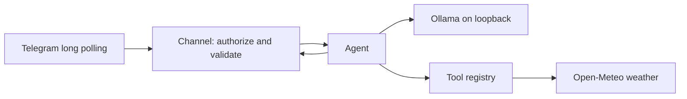

# My AI Assistant — v0.2

A small personal assistant and software-engineering learning project. Model inference runs locally through Ollama; Telegram carries messages and Open-Meteo supplies today's Kanata, Ottawa forecast. No agent framework or cloud model fallback.

Implemented: private-chat authorization, Telegram long polling, local tool calling, a validated weather tool, per-user rate limiting, bounded input/polling, safe errors, JSON console logs, and offline tests. Each request is handled independently, without conversation memory.

## Architecture



`assistant.py` starts `personal_assistant/app.py`. Configuration, HTTP transport, model client, orchestration, channel, security, and tools are separate modules. See [architecture](docs/architecture.md) for interfaces and trade-offs.

## First-time setup

These setup instructions cover macOS with Python 3.11+ and Ollama running Qwen3.5 4B. `python-dotenv` is the only third-party runtime dependency.

### 1. Prepare Python

Open a terminal in your checkout (replace the example path below):

```bash
cd /path/to/my-assistant
python3 --version
python3 -m venv .venv
source .venv/bin/activate
python -m pip install -r requirements.txt
```

### 2. Install and configure Ollama

Install [Ollama for macOS](https://ollama.com/download/mac), open it, and download the model:

```bash
ollama pull qwen3.5:4b
ollama run qwen3.5:4b
```

Enter `/bye` to leave the interactive model session. Keep Ollama running on its loopback listener, never `0.0.0.0` or a LAN interface.

Disable Ollama cloud features by merging `"disable_ollama_cloud": true` into `~/.ollama/server.json`, preserving existing settings, and restart Ollama. Alternatively set `OLLAMA_NO_CLOUD=1` in the environment of the **Ollama server**, not just this assistant. See the [official Ollama FAQ](https://docs.ollama.com/faq). Use an installed local model; a localhost URL by itself does not prevent Ollama from forwarding requests to a cloud model.

```bash
curl http://127.0.0.1:11434/api/tags
```

### 3. Create a Telegram bot and obtain your user ID

Create a Telegram bot with [BotFather](https://t.me/BotFather): send `/newbot`, follow the prompts, and privately save the token. Send the new bot a private message.

To retrieve your user ID, stop any bot process first, then use the following local snippet. It asks for the token without echoing it, calls the [Telegram Bot API](https://core.telegram.org/bots/api#getupdates), and prints only IDs from private messages. Keep the output private. If multiple IDs appear, identify your own before configuring access. A webhook must not be configured for long polling to work.

```bash
python - <<'PY'
import getpass
import json
import urllib.request

token = getpass.getpass("Bot token: ")
try:
    request = urllib.request.Request(
        f"https://api.telegram.org/bot{token}/getUpdates",
        data=json.dumps({"timeout": 0, "limit": 100, "allowed_updates": ["message"]}).encode(),
        headers={"Content-Type": "application/json"},
    )
    with urllib.request.urlopen(request, timeout=15) as response:
        result = json.load(response)
    ids = {u["message"]["from"]["id"] for u in result.get("result", [])
           if u.get("message", {}).get("chat", {}).get("type") == "private"}
    print(sorted(ids) if ids else "Send a fresh private message to your bot, then retry.")
except Exception:
    print("ID lookup failed. Check the token, network, certificates and webhook settings.")
PY
```

### 4. Configure the assistant

For a **new checkout only**, copy `.env.example` to `.env` and restrict its permissions:

```bash
cp .env.example .env
chmod 600 .env
```

If `.env` already exists, preserve it. Edit it yourself using `.env.example` as the reference. Required values are `TELEGRAM_BOT_TOKEN` and a positive `TELEGRAM_ALLOWED_USER_ID`. Existing v0.1 configuration remains compatible; omitted new settings use defaults. Exported environment variables take precedence over `.env`.

| Setting | Default | Meaning |
|---|---|---|
| `OLLAMA_URL` | `http://127.0.0.1:11434/api/chat` | Loopback HTTP endpoint only |
| `OLLAMA_MODEL` | `qwen3.5:4b` | Installed local model |
| `TIMEZONE` | `America/Toronto` | Forecast and prompt timezone |
| `RATE_LIMIT` | 10 | Requests per user in a sliding 60-second window |
| `MAX_MESSAGE_LENGTH` | 2000 | Reject longer text; maximum 4096 |
| `MAX_TOOL_CALLS` | 2 | Maximum batch; larger batches execute nothing |
| `POLL_LIMIT` | 10 | Maximum updates per fetch; maximum 100 |
| `MAX_MESSAGE_AGE` | 300 | Ignore messages older than this at batch arrival, seconds |
| `CONNECT_TIMEOUT` | 10 | Connection timeout, seconds |
| `INFERENCE_TIMEOUT` | 180 | Model socket timeout, seconds |
| `EXTERNAL_TIMEOUT` | 45 | Telegram/weather socket timeout; must exceed 25 seconds |
| `REQUEST_BUDGET` | 400 | Budget checked between agent operations, seconds |

### 5. Test and launch

Run `python -m unittest discover -v` from the repository root. If it ends with `OK`, follow the launch steps below, then send `/start` and a weather question to your bot.

## Subsequent launches (including after a restart)

You do not need to recreate the virtual environment, copy `.env`, or download the model each time.

### 1. Start Ollama

Open **Ollama** from Applications or Spotlight. Alternatively, from Terminal:

```bash
open -a Ollama
```

Wait a few seconds, then check the local server:

```bash
curl --fail --max-time 10 http://127.0.0.1:11434/api/tags
```

You should see JSON listing installed models, including `qwen3.5:4b`. If the connection is refused, wait and retry; check that the Ollama application is running. The persistent `disable_ollama_cloud` setting from first-time setup continues to apply after restarting. See the [Ollama FAQ](https://docs.ollama.com/faq) for server settings.

You do **not** need an interactive `ollama run` session for the assistant. Its first request loads the installed model as needed, so the first response may be slower.

If you prefer running the server directly in a terminal, quit the Ollama application first, then run:

```bash
OLLAMA_NO_CLOUD=1 OLLAMA_HOST=127.0.0.1:11434 ollama serve
```

Keep that terminal open and use a second terminal for the assistant. Choose either the application or the terminal server; running both causes a port conflict.

### 2. Start the assistant

In a terminal, replace the example path with your checkout location:

```bash
cd /path/to/my-assistant
source .venv/bin/activate
python assistant.py
```

Look for the `assistant_started` JSON event, then send a fresh private message to the bot. This event confirms the polling loop started; subsequent error events indicate connection or configuration problems. Run only one assistant process, and keep the Mac awake and connected.

### 3. Stop it

Press **Ctrl+C** in the assistant terminal. Optionally run `deactivate` to leave the virtual environment. Stopping the assistant does not stop Ollama: quit its application separately, or press Ctrl+C in the terminal running `ollama serve`.

After a reboot, repeat steps 1 and 2. This project does not install an automatic background service.

## Unit tests (offline)

Run from the repository root:

```bash
python3 -m unittest discover -v
```

The suite uses Python's built-in `unittest`. It does not read `.env`, need credentials or `python-dotenv`, or contact Telegram, Ollama, or Open-Meteo. Ollama can remain stopped. The suite also includes a mocked end-to-end weather flow.

A successful run ends with `OK`. Some tests intentionally print safe failure events while exercising error handling; these do not indicate a failed test. Actual failures appear as `FAIL` or `ERROR` in the test results.

For focused checks:

```bash
# Configuration and HTTP transport
python3 -m unittest tests.test_config tests.test_http_client -v
# Agent, tool validation, Ollama and weather responses
python3 -m unittest tests.test_agent tests.test_services -v
# Authorization, rate limits and polling
python3 -m unittest tests.test_telegram -v
# Mocked end-to-end flow and response safety
python3 -m unittest tests.test_end_to_end -v
# One regression test
python3 -m unittest tests.test_telegram.BatchTimingTests.test_slow_first_request_does_not_expire_fresh_batch -v
```

## Manual live validation

With Ollama and the assistant running, use your own configured Telegram account. These checks contact real services and are separate from the offline tests.

Manual checklist:

1. Send `/start`, a normal question, and a weather/umbrella question from the authorized private chat.
2. Confirm JSON events show inference and weather execution without message contents or identifiers.
3. Confirm `/id` returns an unknown-command response; no bootstrap bypass exists.
4. Send an oversized message and a photo: expect safe text guidance.
5. Send more than ten requests within a minute: excess requests are silently ignored. Commands and invalid inputs also consume the quota.
6. If another account is available, confirm its messages and group messages receive no replies.
7. Stop Ollama and send a question: expect a safe service error. Restart Ollama afterward.

The automated suite exercises these failure paths without real credentials. Live compatibility and actual model answer quality require this manual check.

## Privacy and limitations

- Telegram bots are not end-to-end encrypted. Telegram receives conversations; Open-Meteo receives fixed coordinates. Local inference does not mean offline operation.
- No shell or filesystem tools exist. Model tool requests pass through a fixed allowlist and argument validation.
- Only approved private senders are processed.
- Inference URLs require loopback IPs or `localhost` (normalized to `127.0.0.1`). The transport ignores proxy environment settings, does not follow redirects, verifies TLS, and caps JSON responses at 1 MB.
- Ollama is a trusted local dependency: disable its cloud features. Model-name checks are defense in depth, not proof of local execution. This application does not configure or audit the Ollama server.
- One request runs at a time. Telegram retains its own pending queue; this application processes bounded batches and skips messages already stale when their batch arrives. Slow processing does not expire later messages within that batch. Offsets are in memory, not durable. A crash can cause a recent update to replay; failed sends are not retried automatically.
- Socket timeouts and between-operation budgets are not strict wall-clock cancellation. No memory or scheduler is implemented.
- Logs contain event categories, controlled error codes, numeric HTTP statuses, and timings, never raw prompts, IDs, tokens, response bodies, or exception strings. They are console-only; event timing still reveals activity patterns.

## Troubleshooting

| Symptom | Action |
|---|---|
| `startup_failed` | Check required settings, positive limits, timezone, local URL and dependency installation. Values are intentionally not printed. |
| `No module named dotenv` | Activate `.venv`; run `python -m pip install -r requirements.txt`. The package is named `python-dotenv`. |
| Settings seem ignored | Exported variables override `.env`; unset obsolete exports locally. |
| Certificate verification fails on python.org Python 3.13 | Run `/Applications/Python 3.13/Install Certificates.command`, then retry. Never disable TLS verification. See [Python macOS setup](https://docs.python.org/3.13/using/mac.html). |
| `poll_failed` | Check connectivity, token, certificates, webhook configuration, and that only one bot process runs. |
| `inference_failed` | Check Ollama is running, the model is installed, and the inference timeout is sufficient. |
| `tool_failed` | Check Open-Meteo connectivity; invalid/missing response fields fail safely. |
| No reply | Check sender ID/private chat, rate limit, message age, and console events. |
| Slow first reply | The model may need loading into memory. |

## License

No license has been selected.
