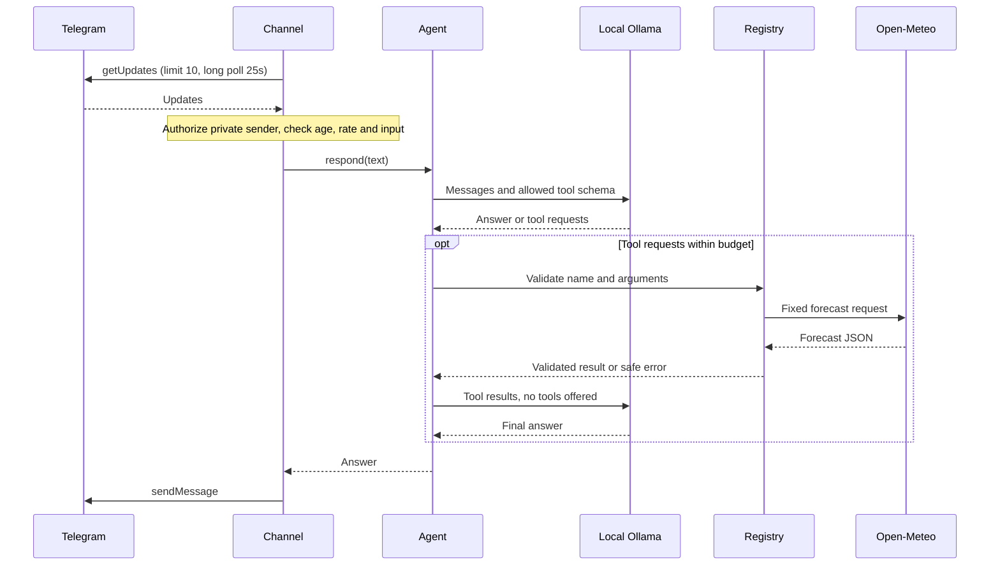

# Architecture

## Responsibilities and interfaces

| Component | Interface and responsibility |
|---|---|
| `app.py` | Loads settings at startup and wires concrete objects |
| `config.py` | `Settings.from_mapping()` validates explicit values; `load_settings()` is the only credential loader |
| `http_client.py` | `request(url, payload, timeout)` performs bounded JSON I/O; safe `ServiceError` categories |
| `channels/telegram.py` | `poll_once()`, `handle(update)`, `send(chat_id, text)` own the Telegram protocol |
| `security.py` | Private sender authorization, text validation, sliding-window limiter |
| `agent.py` | `respond(text)` owns a single request's model/tool conversation |
| `ollama.py` | `chat(messages, tools, timeout)` validates model response envelopes |
| `tools/registry.py` | Explicit weather schema and `execute(name, arguments)` validation |
| `tools/weather.py` | Fixed Kanata forecast request and validated response mapping |
| `logging_setup.py` | Structured console events with deliberately selected fields |

## Decisions

Synchronous execution provides one in-flight inference without queues, locks or worker pools. Polling batches and HTTP bodies are bounded. Telegram owns the upstream queue; messages already older than five minutes when a batch arrives are discarded. The arrival timestamp is reused throughout that batch so slow inference does not expire fresh entries. Rate limiting uses monotonic time and is stored only for authorized users. Message age uses wall time. Keep the host clock accurate.

The agent uses at most two model calls. A batch above the configured tool budget executes nothing. Structurally malformed batches also execute nothing; individual unknown names/invalid arguments return safe tool errors. No recursive tool loop exists. A final response that asks for more tools is rejected. Invalid Unicode and blank model answers fail safely before Telegram delivery; empty prose is allowed during tool selection. Null weather measurements remain null and are described as missing rather than invented values.

Plain constructors permit fake models, transports, tools and clocks in tests. There are no interface hierarchies, agent frameworks, plugin discovery, persistence layers or future-feature placeholders. `assistant.py` preserves the existing launch command. Importing modules never loads configuration.

## Security boundaries

Incoming Telegram updates and model outputs are untrusted. Authorization happens before commands; `/id` has no privileged behavior. The only executable tool is fixed-location weather with an empty argument object. Adding a tool requires explicit code, validation and tests. User authentication must not serve as blanket authorization for a future sensitive action.

Model requests require HTTP loopback endpoints. `localhost` is normalized to a numeric address, avoiding DNS resolution. HTTP redirects and environmental proxy routing are disabled by using direct HTTP connections. External API calls use HTTPS with default certificate validation. Response bodies are capped at 1 MB. No fallback inference service exists.

The Ollama runtime and host remain trusted. The user must disable Ollama cloud features and keep its listener bound to loopback. Rejecting obvious cloud model names cannot detect custom aliases or a modified local server. These application safeguards are not a network sandbox.

Connection and socket read timeouts are independently configurable. The agent checks an elapsed-time budget before each operation and reduces inference timeouts to the remaining budget. In-progress tools are bounded by their own socket timeouts. Slow streaming peers can exceed these budgets; hard process-level cancellation is not implemented.

Logs record request IDs, event categories, durations, allowlisted error codes and numeric HTTP statuses. Unknown exceptions use an unexpected-error category; exception messages are never logged. They omit actual sender IDs, prompts, tokens, URLs, raw model replies and exception strings. Failures are intentionally less detailed to avoid leaking credentials carried in Telegram API paths. Startup failures point to configuration/dependencies without printing values.

Offsets advance before processing and are confirmed on the next poll. Individual failed updates do not block the remainder of a batch. Delivery is not exactly-once: a crash can replay recent updates; a failed response can be lost. This is acceptable for read-only weather but must be revisited before adding side effects. No inbound ports are opened by this application.

## Validation and later work

Tests use standard-library unittest and fakes; no credentials, dotenv loading, network, or Ollama is needed. Live smoke-testing remains a user action.

Later channels can call `Agent.respond`; additional tools belong in the explicit registry. Memory, scheduling, approvals and deployment choices should be designed when their requirements are known, without adding unused scaffolding now.
